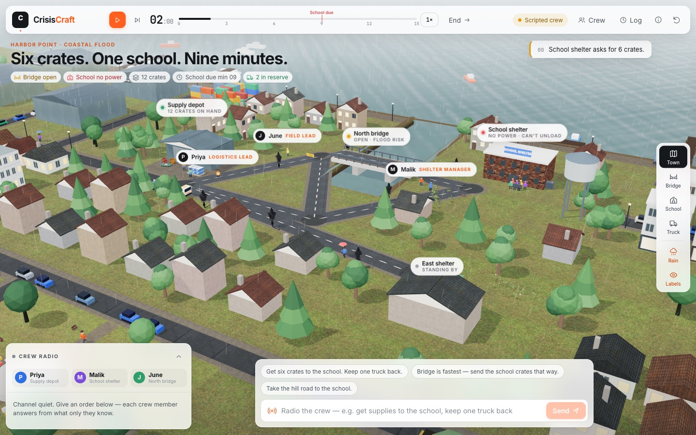
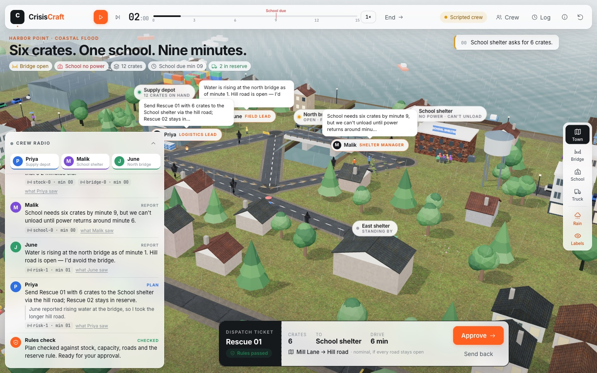
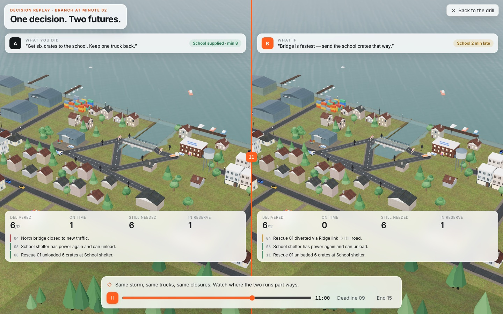

<div align="center">
  
  <h1>CrisisCraft</h1>
  <p><strong>Practise the crisis before it happens.</strong></p>
  <p>A flooded town. A crew who each know a different part of the story. One decision you can take back.</p>
</div>

The water is rising in Harbor Point. The school shelter needs six crates of supplies by minute 9, but it has no power to unload them. The north bridge is the fastest way there, and nobody is sure how long it will stay open.

In **CrisisCraft** you are the coordinator. You give orders in your own words to a crew of three people. Each crew member is powered by a **Meta model** and knows only what that person would really know. They report, disagree and propose a plan. The simulation checks every plan against the town's rules before you can approve it. When the minutes have run out, **rewind one decision** and watch the other future play out beside the first.



## Meet the crew

| | Who | What they know |
| --- | --- | --- |
| 🟦 | **Priya**, logistics lead at the supply depot | Stock, truck capacity and the road map. She drafts every plan. |
| 🟪 | **Malik**, shelter manager at the school | What each shelter needs, by when, and whether it can unload. |
| 🟩 | **June**, field lead at the north bridge | What the water is doing to the roads right now. |

Nobody sees everything. Priya has the road map, but only June has seen the water at the bridge. If June's warning never reaches the radio, Priya will happily send a truck over it.



## Try a drill in three minutes

1. **Give an order.** Type something like *"Get supplies to the school, keep one truck back"*, or choose a suggestion.
2. **Listen to the radio.** Priya, Malik and June each reply from their own briefing. Open **What they saw** under any message to see the exact facts that person was given.
3. **Read the plan.** Priya proposes a truck, crates and a route. The rules check passes it or refuses it. A refused plan goes back to her with the reason, and she gets one revision.
4. **Approve and watch.** The truck rolls through the storm. The bridge may close. The school's power may come back. Every moment is recorded.
5. **Rewind.** In the **Log**, choose **Rewind** on your decision. You return to that minute with the same storm and a fresh choice. Then open **Decision replay** to watch both futures side by side, with a debrief that names the event that made them different.

## What it teaches

| Concept | In the drill |
| --- | --- |
| **Bounded knowledge** | Each model call receives only that role's observations, each marked with how old it is. |
| **The crew proposes, you decide** | The model never moves a truck. Only your approval changes the world. |
| **Rules the model can't bend** | Stock, capacity, closed roads and the one-truck reserve are enforced in code, not in the prompt. |
| **Rewind one decision** | Same world, same events, one changed order. The difference comes from recorded events, not a guess. |



## How Meta models are used

Every turn on the radio is a separate call to the **Meta Model API** (`muse-spark-1.3` by default) with schema-constrained JSON output:

- **Three role reports run in parallel.** Each report sees only its own briefing, projected by the engine from the world state. The future schedule, other roles' private reports and the true road status are never in the prompt.
- **A planning turn** sees Priya's briefing plus what her teammates said on the radio. It must return a structured plan: truck, request, quantity and route.
- **June's field photo uses three Meta models in one radio turn.** Press **Bridge photo**: **Muse Image** (`muse-image-1.0`) generates a synthetic drill image of what June would see at the north bridge right now, with the water level taken from the engine's true state; **SAM 3.1** outlines the bridge and the floodwater, and we measure the overlap of the detected bridge and water masks in the generated drill image; **Muse Spark** reads the photo with that measurement and makes the call (*passable, risky, not passable*). Her reading goes onto the radio Priya hears when she plans next.
- **Spoken orders** go through **Muse Voice Transcribe** (`muse-voice-transcribe-1.0`). Click the mic, speak, click again: the browser records a 24 kHz WAV, the server forwards it to `/v1/asr/transcribe` in push-to-talk mode, with the crew's names and the town's roads as vocabulary hints, and the transcript becomes your order.
- **Priya plans as a tool-using agent.** Her planning turn runs a Chat Completions tool loop with three functions served by our engine: `list_routes` (her paper map only, no live road status), `check_plan` (the rules validator, dry run) and `submit_plan`. Each call shows on the radio as it happens, so you can watch her test the bridge, get refused, and reroute or hold.
- **A verifiable after-action review.** At the end of a drill, or in decision replay, **Muse Spark** reads both runs' engine logs and what each crew member knew at each order, then writes the debrief. Every finding must cite event ids; the server checks each one against the replayed runs and removes any finding that cites an event that never happened, and the review says how many it removed.
- **Teammates review the plan.** When Priya's plan passes the rules, Malik and June each check it against what *they* know, in parallel, and answer *agree* or *concern* on the radio. One concern earns Priya a revision, where she changes the plan or answers the concern out loud; a route the commander named still wins.
- **The crew speaks up on its own.** When the engine delivers a new report to a crew member mid-drill (the bridge closing, the east shelter calling, the school's power returning), the clock pauses and that person radios in unprompted. Priya answers with what should change, ready for approval. Toggle it with **Auto** on the radio.
- **Autopilot: an AI commander.** Switch on **Autopilot** and Muse Spark takes your seat. It sees only what you would see (the public board, public reports and the crew radio) and picks one move at a time: order, approve, send back, or let the clock run. It acts through the same controls you use, so every rule still applies. Rewind and play the same moment yourself, then compare your run with its run in decision replay.
- **Agents act on the map.** While Priya dry-runs a plan, the route she is testing lights up in the town; a route over a closed road glows red.
- **A guardrail loop** dry-runs that plan in the deterministic engine. If the plan is refused, the reason goes back to the model for one revision. Two refusals mean nothing happens, and the crew says so.

### Does bounded knowledge actually matter? We measured it

Thirty live Muse Spark drills from the same moment (minute 2: bridge still open, June has seen the water rising, the bridge closes at minute 4):

| Condition | Took the hill road | School supplied on time | Plan cites June's warning | June objected in review |
| --- | --- | --- | --- | --- |
| Full radio, "get six crates to the school" | **10 of 10** | **10 of 10** | 10 of 10 | 0 of 10 (no false alarms) |
| Same order, **June kept off the radio** | 0 of 10 | **0 of 10** | 1 of 10 | silenced |
| Full radio, "bridge is fastest, go that way" | 0 of 10 (followed the order) | 0 of 10 | **10 of 10 warned you** | **10 of 10** |

The planner never sees the true road state. When the one person who saw the water is silenced, every plan sends the truck into the closure. When the commander insists on the bridge, June objects in review every time, and the crew complies while saying the warning out loud. She never objected to the safe hill road. Every plan passed the rules check on the first try. Details and raw runs: [docs/eval/crew-eval.md](docs/eval/crew-eval.md); reproduce with `npm run eval:crew`.

Turns stream to the browser as they arrive. Each turn shows its latency, token count and the exact briefing the model received. Muse Spark Open on Baseten works through the same OpenAI-compatible interface by changing `MODEL_BASE_URL` and `MODEL_NAME`.

**Without a key**, the app runs a deterministic **Scripted crew**. It reads the same bounded briefings and follows the same rules, and the header clearly labels it *Scripted crew · no model key*. It exists so anyone can explore the drill offline. It is not presented as AI.

## Run it locally

You'll need **Node.js 22.12 or newer** (verified with Node 24).

```sh
npm ci
cp .env.example .env      # add MODEL_API_KEY for the live Meta crew; leave blank for the scripted crew
npm run assets:fetch      # CC0 Poly Haven models, textures and sky (Python 3)
npm run dev
```

Open **http://127.0.0.1:5173**. The crew API runs inside the dev server at `/api/crew`, the same handler that ships as the Vercel function.

```sh
npm run check             # 85 engine, crew, workflow and UI regression tests + strict typecheck + production build
npm run meta:check        # one live Muse Spark call and one Voice Transcribe call with your key
npm run build:vercel      # static app + five bundled API functions in .vercel/output
```

## How it's built

| Path | What it does |
| --- | --- |
| `packages/sim` | Pure deterministic engine: stock, trucks, roads, closures, deliveries, metrics, replay |
| `packages/crew` | Roster, bounded briefings, Meta provider, scripted crew, deliberation and guardrail loop, NDJSON handler |
| `packages/contracts` | Shared schemas and types |
| `apps/web` | React + three.js town, command room, crew view, event log and decision replay |
| `server/*.ts` | Vercel functions (bundled into `/api/*`): the crew rebuilds the run from approved commands, then deliberates; voice forwards a spoken order to Muse Voice Transcribe |
| `scenarios/harbor-point.json` | The authored scenario: road graph, reports, closures and requests |

The server never trusts the browser's world state. It replays the approved command history through the engine and builds every briefing from that result. The model can propose a plan, but it can't create supplies, open a closed road, overload a truck or move the clock.

## Honest limits

Harbor Point is **fictional**. Its outcomes describe this authored scenario, not real floods, and nothing here is emergency guidance or evidence of better real-world preparedness. The drill has one scenario and two trucks, with sessions held in memory. Voice, additional scenarios and facilitator tools are next.

See [implementation status](docs/implementation-status.md), the [engine contract](docs/simulation-engine.md), the [concept](research/crisiscraft-concept.md), [contributions](docs/contributions.md) and [assets and licences](docs/assets-and-licenses.md).

Built during the Meta Global AI Developer Hackathon, October–November 2026.

## Submission readiness (1 November 2026)

The [public repository](https://github.com/mk-tdev/crisiscraft) and [recorded live crew evaluation](docs/eval/crew-eval.md) are available. The production app is [crisiscraft.vercel.app](https://crisiscraft.vercel.app), verified accessible without login. The final hosted workflow smoke test, three-minute video, track and full team roster are still to be confirmed in the [submission plan](docs/submission-plan.md). [Contributions](docs/contributions.md) identify the event-built work and third-party components.

Autopilot requests are cancelled on takeover or timeline changes. Crew/photo model workflows have a 50-second total budget under the configured 60-second function limit; timeouts return an explicit retry message and never approve a plan. The photo percentage is image-mask overlap, not flood depth or validated road safety. Run the deployed smoke checklist before recording; local tests do not establish hosted reliability.
